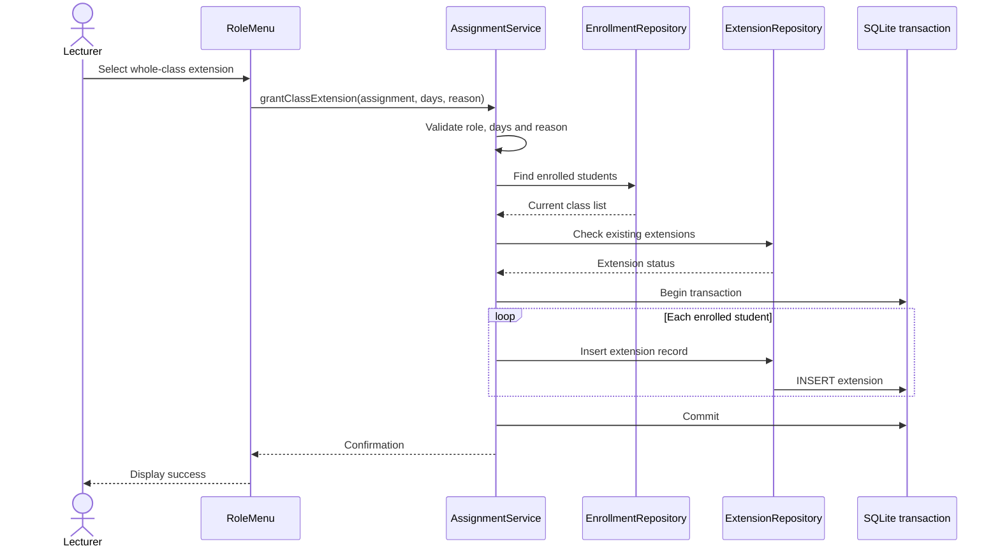

# Change Request Analysis – CR1

**Project:** Moderated Learning Management System  
**Release:** v1.1.0  
**Phase:** Phase 8 – Maintenance

## 1. Change Request

The school requested:

> A lecturer should be able to extend the deadline for a whole class, not just an individual student, and extensions should be shown on the student's assignment list.

The existing system supported individual extensions. CR1 adds whole-class extensions and displays adjusted deadlines to affected students.

## 2. Maintenance Classification

**Classification: Perfective maintenance.**

CR1 is perfective maintenance because it enhances existing functionality in response to a new user requirement. It expands individual deadline extensions to whole classes and improves the information shown on the student assignment list. It is not primarily a defect correction or an adaptation to a new operating environment.

Regression testing is important because deadline calculations also affect submission, resubmission and marking.

## 3. Impact Analysis

### 3.1 Requirements

| Requirement | Impact | Reason |
|---|---|---|
| FR-07 – Student views assignments | Direct | The list displays the effective deadline, extra days and original deadline when extended. |
| FR-08 – Submit/resubmit assignments | Direct | Submission and resubmission must use the effective deadline. |
| Existing extension requirement (C4) | Direct | Lecturers can grant individual or whole-class extensions. |
| FR-02 – Role restrictions | Regression | Only authorised lecturers assigned to the course may grant extensions. |
| NFR-05 – Integrity and persistence | Direct | The class-wide operation must not leave partial changes if an insertion fails. |

### 3.2 Diagrams and Design Documents

No separate UML, ER or sequence diagram source files were found in the repository's `docs` directory. Therefore, no existing standalone diagram file was available to update.

The following sequence diagram documents the new logical interaction:

If validation fails, the class is empty, an extension already exists, or an insertion fails, the operation is rejected without committing partial changes. The existing database ER structure is unchanged.

### 3.3 Classes and Components

| Class / component | Impact | Explanation |
|---|---|---|
| `AssignmentService` | Modified | Adds `grantClassExtension()` to grant extensions to enrolled students in a transaction. |
| `StudentPortalService` | Modified | Retrieves each student's extension for their assignments. |
| `AssignmentView` | Modified | Stores `extraDays` and calculates `effectiveDeadline()`. |
| `RoleMenu` | Modified | Offers individual or whole-class extension scope. |
| `System` | Modified | Injects the extension repository into the student portal service. |
| `Extension` | Reused | Represents one student's extension for one assignment. |
| `IExtensionRepository` | Reused | Adds and finds extension records. |
| `SqliteExtensionRepository` | Reused | Uses the existing SQLite extension table. |
| `SubmissionService` | Regression impact | Continues enforcing the effective deadline. |
| `MarkingService` | Regression impact | Continues calculating late penalties using the effective deadline. |
### 3.4 Database Tables

| Table | Impact | Explanation |
|---|---|---|
| `extension` | Reused, unchanged | Stores one extension per student and assignment. A class-wide request creates one row per enrolled student. |
| `enrollment` | Read by new operation | Identifies students currently enrolled in the assignment's course. |
| `assignment` | Read by new operation | Provides the assignment and its course. |
| `submission` | No schema change | Existing submission data and behaviour remain unchanged. |

**No database migration is required.**

The existing `extension` table already provides:
- `student_id` and `assignment_id` foreign keys.
- A positive-value check on `extra_days`.
- A mandatory, non-blank reason.
- `UNIQUE (student_id, assignment_id)` to prevent duplicate extensions.

The unique constraint is retained. Class-wide extensions are represented by separate student extension records.
### 3.5 Tests Affected

| Test | Purpose |
|---|---|
| `Extension.ClassWideAppliesToEveryEnrolledStudentAndAppearsInPortal` | Verifies extensions for all enrolled students, portal display and submission within the extended period. |
| `Extension.ClassWideRequestIsRejectedIfAnyStudentAlreadyHasAnExtension` | Verifies rejection when a student already has an extension. |
| `Extension.Rules` | Protects individual extension rules. |
| `Submit.ExtensionMovesTheDeadlineForThatStudentOnly` | Protects individual extension submission behaviour. |
| `Submit.OnTimeThenResubmitBeforeDeadline` | Protects normal submission and resubmission. |
| `Submit.LateWorkIsAcceptedNotRejected` | Protects late submission handling. |
| `Submit.ResubmissionAfterDeadlineRefused` | Protects deadline enforcement. |
| `Marking.AppliesLatePenaltyUsingEffectiveDeadline` | Protects late-penalty calculations. |
| `Portal.StudentSeesOnlyOwnCoursesAndAssignments` | Protects student-specific assignment visibility. |
| `AccessControl.EveryRoleIsBlockedFromOtherRolesFunctions` | Protects role restrictions. |
| `Database.ConstraintsAreEnforced` | Protects database constraints. |
| `Database.RolledBackTransactionLeavesNoTrace` | Protects transaction rollback. |
## 4. Implementation in v1.1.0

The lecturer menu offers two extension scopes:
1. Individual student.
2. Whole class.

For a whole-class request, `AssignmentService::grantClassExtension()`:

1. Checks the user's permission.
2. Validates the extension period (1–30 days) and reason.
3. Confirms that the assignment exists and the lecturer teaches its course.
4. Retrieves the currently enrolled students.
5. Rejects an empty class.
6. Rejects the request if any student already has an extension.
7. Inserts one extension record per student inside a transaction.
8. Commits only after all insertions succeed.

The student portal retrieves the student's extension and calculates the effective deadline. The assignment list displays the effective deadline and, where extended, the extra days and original deadline.

Individual extensions remain supported.
## 5. Regression Testing and Results

The full GoogleTest suite was run after implementation.

**Result: 45 tests passed, 0 failed.**

The two new CR1 tests verify class-wide application and rejection when an individual extension already exists. Existing tests cover submission, resubmission, deadline enforcement, late penalties, access control, database constraints and rollback.

The CMake build succeeded, and CTest reported all tests passing.
## 6. Release and Documentation Updates

The change is prepared as release **v1.1.0**, with release tag `v1.1` planned for the completed release.

Updated documentation:
- `docs/IMPLEMENTATION_NOTES.md`
- `docs/user-manuals.md`
- `docs/release-notes.md`
- `docs/change-request-CR1.md` (this analysis)

## 7. Conclusion

CR1 was implemented as a perfective maintenance change. Lecturers can grant extensions to an individual student or a whole class, and students can see their adjusted deadlines. The existing database design is reused without a schema migration. All 45 regression tests passed.
